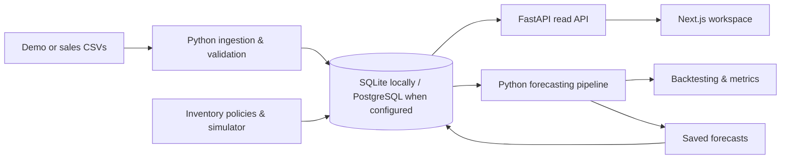

<div align="center">

# DEMAND<span style="color:#d9b65d">IQ</span>

### Probabilistic demand forecasting & inventory intelligence

Explore sales signals, review saved forecasts, and inspect inventory recommendations in a dark, data-focused workspace.


[Features](#what-you-can-do) · [How it works](#how-it-works) · [Quick start](#quick-start) · [API](#api) · [Roadmap](#current-scope)

</div>

---

## What you can do

<details open>
<summary><strong>Explore the workspace</strong></summary>

| Area | What it shows | Current state |
|---|---|---|
| **Overview** | Sales coverage, stores and products, recent forecast activity, and a selected demand series | Available in Next.js |
| **Demand signals** | Historical sales by store and product, with daily details | Available in Next.js |
| **Forecast runs** | Saved model runs, evaluation metrics, and forecast intervals | Available in Next.js; runs are created by the Python pipeline |
| **Inventory advisor** | Saved replenishment suggestions and their explanation | Available in Next.js when recommendations exist |
| **Forecast engine** | Naive, seasonal-naive, ETS, and LightGBM forecasting with rolling-origin backtesting | Python modules and CLI |
| **Inventory engine** | Reorder-point and periodic-review policies, plus inventory simulation | Python modules |
| **Data pipeline** | Demo data generation, CSV ingestion, and input validation | Python CLI |

</details>

<details>
<summary><strong>How forecasts are evaluated</strong></summary>

DemandIQ includes rolling-origin backtesting and measures such as MAE, RMSE, WAPE, and MASE. It also calculates prediction intervals and records observed interval coverage. Forecast quality should be judged against the data and series being evaluated; interval coverage is measured evidence, not a guarantee.

</details>

## How it works



The Next.js app reads data through FastAPI. Forecasting and inventory calculations live in Python, so the business logic is separate from the interface. Today, the web UI displays saved results; forecast creation and recommendation controls have not yet been added to the Next.js/API workflow.

## Quick start

### 1. Install Python dependencies

From the repository root:

```powershell
python -m pip install -e .
```

Python 3.11 or newer is required. SQLite is used by default for local development. Set `DATABASE_URL` to a PostgreSQL connection string to use PostgreSQL instead.

### 2. Load demo data

To use the demo CSVs already in `data/demo/`:

```powershell
python scripts/run_pipeline.py --ingest
```

To regenerate the demo data first:

```powershell
python scripts/run_pipeline.py --generate-demo --ingest
```

### 3. Start the API

In the first terminal, from the repository root:

```powershell
python -m uvicorn demandiq.api.main:app --reload
```

The API health check is at <http://localhost:8000/health>; interactive API docs are at <http://localhost:8000/docs>.

### 4. Start the website

In a second terminal:

```powershell
cd web
npm install
npm run dev
```

Open <http://localhost:3000>.

<details>
<summary><strong>Connect to PostgreSQL or a hosted API</strong></summary>

Set these environment variables in your local environment or hosting provider:

| Variable | Used by | Purpose |
|---|---|---|
| `DATABASE_URL` | FastAPI / Python | SQLAlchemy database connection. Use PostgreSQL for hosted deployments. |
| `DEMANDIQ_CORS_ORIGINS` | FastAPI | Comma-separated frontend origins allowed to call the API. |
| `NEXT_PUBLIC_DEMANDIQ_API_URL` | Next.js | Base URL of the FastAPI service; locally defaults to `http://localhost:8000`. |

For local Next.js configuration, put `NEXT_PUBLIC_DEMANDIQ_API_URL` in `web/.env.local`. Never commit database credentials or other secrets.

</details>

## API

The current API is read-only:

| Method | Endpoint | Purpose |
|---|---|---|
| `GET` | `/health` | API and database health |
| `GET` | `/api/v1/overview` | Workspace summary |
| `GET` | `/api/v1/stores` | Store list |
| `GET` | `/api/v1/products` | Product list |
| `GET` | `/api/v1/sales/{store_id}/{product_id}` | Sales history for one series |
| `GET` | `/api/v1/forecast-runs` | Saved forecast runs |
| `GET` | `/api/v1/forecast-runs/{run_id}` | Run details and forecasts |
| `GET` | `/api/v1/inventory/recommendations` | Saved replenishment recommendations |

## Current scope

<details>
<summary><strong>Implemented</strong></summary>

- Next.js pages for overview, demand signals, forecast runs, and inventory recommendations.
- FastAPI endpoints to read the workspace data and saved results.
- Python data ingestion, validation, feature engineering, forecasting, backtesting, and inventory modules.
- SQLite for local use and PostgreSQL support through `DATABASE_URL`.

</details>

<details>
<summary><strong>Next product steps</strong></summary>

- Add authenticated API actions to run forecasts and create inventory recommendations.
- Add matching controls and parameter forms to the Next.js pages.
- Add database migrations and a deployment-safe data initialization process.
- Deploy the frontend, API, and PostgreSQL database.

</details>

## Development checks

```powershell
python -m pytest
```

```powershell
cd web
npm run lint
npm run build
```

---

<div align="center">

**DemandIQ** · Built with Python, FastAPI, Next.js, and PostgreSQL

</div>
