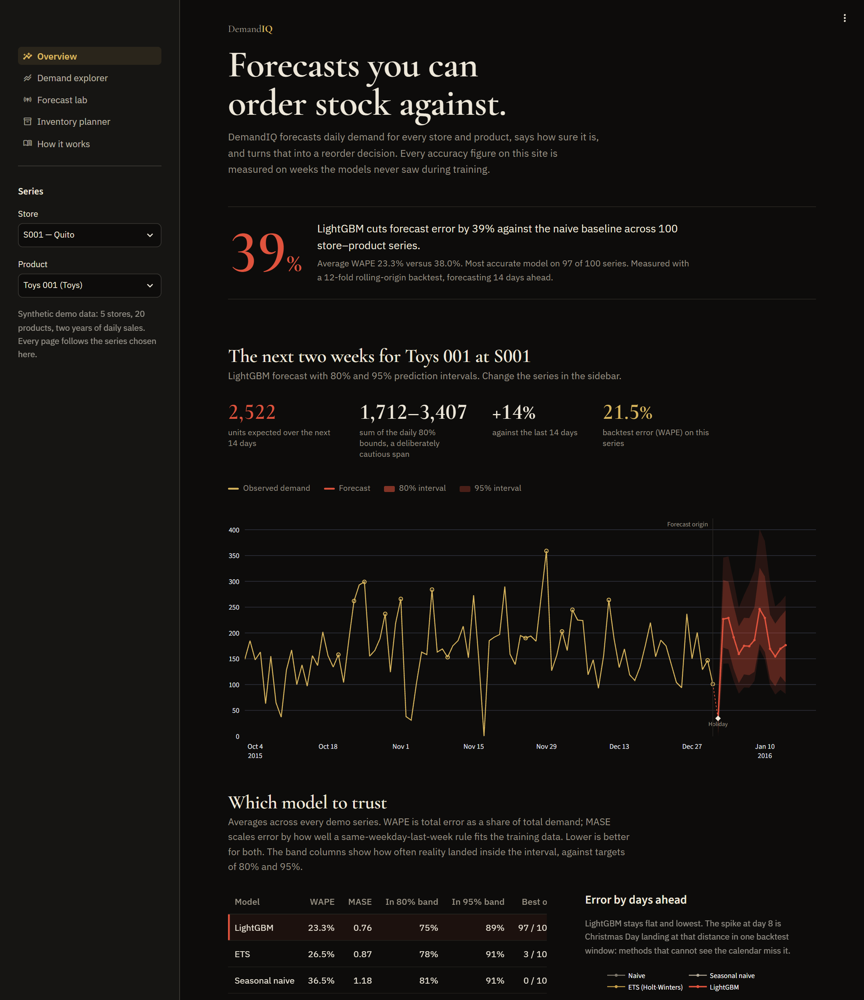
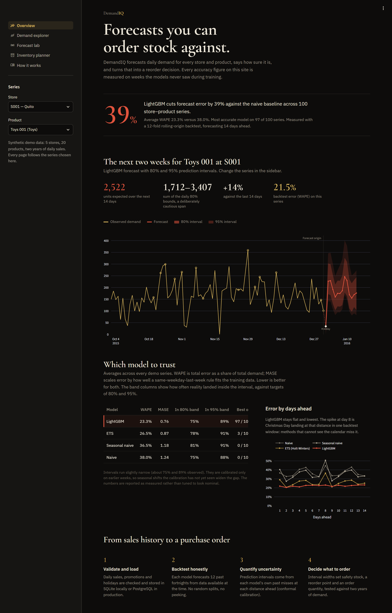
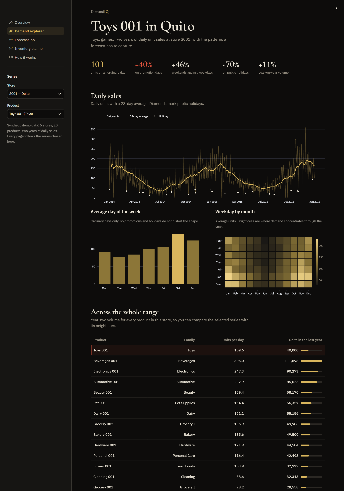
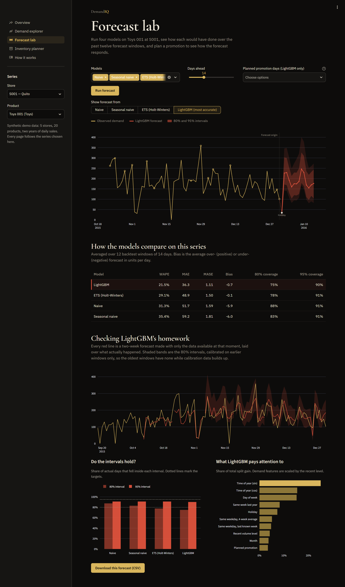
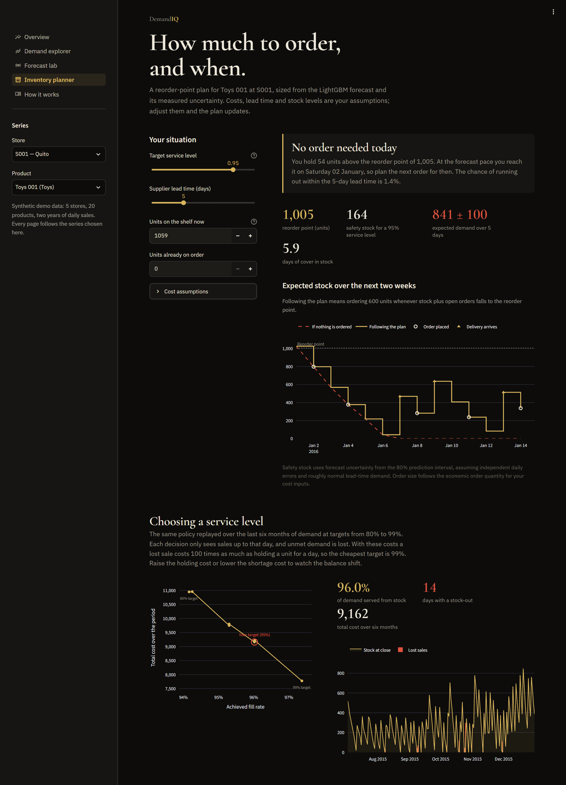
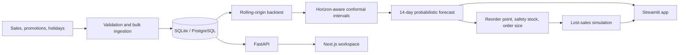

# DemandIQ

**Probabilistic demand forecasting and inventory planning, measured honestly.**

DemandIQ forecasts daily demand for every store and product, puts a calibrated uncertainty band
around each forecast, and turns that band into a reorder decision. Every accuracy figure comes
from a rolling-origin backtest on weeks the models never trained on.




## Results

Benchmarked on 100 store–product series (5 stores × 20 products, two years of daily sales),
forecasting 14 days ahead over 12 rolling backtest windows:

| Model | WAPE | MASE | Inside 80% band | Inside 95% band | Most accurate on |
|---|---:|---:|---:|---:|---:|
| **LightGBM** | **23.3%** | **0.76** | 75% | 89% | **97 / 100** |
| ETS (Holt-Winters) | 26.5% | 0.87 | 78% | 91% | 3 / 100 |
| Seasonal naive | 36.5% | 1.18 | 81% | 91% | 0 / 100 |
| Naive | 38.0% | 1.24 | 75% | 88% | 0 / 100 |

LightGBM's error is **39% lower than the naive baseline**. The intervals come out a little
narrow: 75% and 89% observed against 80% and 95% targets. That's reported as measured; the
[limits](#known-limits) section explains why.

Reproduce the table with `python scripts/run_benchmark.py`. It takes about two minutes with 12 worker processes.

## The app

| | |
|---|---|
| **Overview.** The headline result, a live forecast for any series, the model leaderboard, and error by days ahead. | **Demand explorer.** Promotion lift, weekday and seasonal patterns, holidays, and how the series compares with the rest of the store's range. |
|  |  |
| **Forecast lab.** Run all four models live, plan a promotion and watch LightGBM respond, replay the backtest, check interval coverage and feature importance, export the forecast. | **Inventory planner.** Set service level, lead time, stock and costs to get a reorder decision, a projected stock path, and a six-month simulation of what each service level costs. |
|  |  |

## How it works



**Evaluation without leakage.** Twelve forecast origins, one week apart, each forecasting 14 days
from only the history before it. No random splits. Accuracy is reported as WAPE, MASE and bias.
MAPE is left out because it breaks on zero-sales days.

**LightGBM as one direct multi-horizon model.** Each training row pairs a forecast origin with a
day ahead. Features are things known at the origin: recent demand, rolling level and volatility,
same-weekday history, and last year's demand around the target date. They also include facts
known in advance about the target day: weekday, season, holidays and planned promotions. Demand
inputs and the target are divided by the recent 28-day level, so the trees learn shapes rather
than volumes and can follow trends. A test checks that changing demand after the origin cannot
change a forecast.

**Intervals calibrated on real misses.** For each distance ahead, the band comes from the model's
own backtest errors at similar distances. Errors are scaled by the square root of the forecast
level, since busy days miss by more in absolute terms. Signed quantiles keep the bands
asymmetric for skewed demand. Coverage is tested sequentially: a backtest window is only
calibrated on earlier windows that had fully played out before its origin.

**From forecast to order.** The 80% band becomes a per-day error standard deviation. Lead-time
demand and its spread set the reorder point at the chosen service level. Order size follows
the economic order quantity. A lost-sales simulator replays six months of demand and makes each
decision with only the data available on that day.

## Quick start

```powershell
python -m pip install -e ".[dev]"
streamlit run streamlit_app.py
```

The app creates a local SQLite database and loads the demo data on first run. Then open
<http://localhost:8501>.

### Command-line pipeline

```powershell
python scripts/run_pipeline.py --ingest
python scripts/run_pipeline.py --train --recommend --sample
python scripts/run_benchmark.py
```

`--train` backtests and saves forecasts. Re-running replaces earlier runs instead of duplicating
them. `--recommend` saves a reorder recommendation per series from its most accurate model.
`--generate-demo` rebuilds the synthetic data.

### API and Next.js workspace

```powershell
python -m uvicorn demandiq.api.main:app --reload
```

```powershell
cd web
npm install
npm run dev
```

The FastAPI service exposes read endpoints (`/health`, `/api/v1/overview`, `/stores`,
`/products`, `/sales/{store}/{product}`, `/forecast-runs`, `/forecast-runs/{id}`,
`/inventory/recommendations`) with docs at <http://localhost:8000/docs>. The Next.js app at
<http://localhost:3000> reads saved runs and recommendations from it. Set `DATABASE_URL` to a
PostgreSQL connection string to use PostgreSQL instead of SQLite.

## Deploying the Streamlit app for free

1. Push the repository to GitHub.
2. Create an app at [share.streamlit.io](https://share.streamlit.io), pick the repository, and set
   the main file to `streamlit_app.py`.
3. `requirements.txt` installs the package. The demo database builds itself on first load.

## Project layout

```text
streamlit_app.py            Streamlit entry point and navigation
src/demandiq/
  app/                      Streamlit theme, charts, cached data access, pages
  forecasting/              baselines, ETS, LightGBM, backtesting, conformal intervals, metrics
  inventory/                reorder-point and periodic-review policies, simulator
  services/                 forecast and inventory orchestration (pure functions + persistence)
  data/                     ingestion, validation, features, holiday calendar
  database/                 SQLAlchemy models, connection, repositories
  api/                      FastAPI read API
scripts/                    pipeline CLI, benchmark, demo-data generator
web/                        Next.js workspace
tests/                      27 tests: leakage, intervals, inventory maths, pipeline, API
```

## Development checks

```powershell
python -m pytest
python -m ruff check src scripts tests streamlit_app.py
```

## Known limits

- **The demo data is synthetic.** It has realistic structure: weekly and annual seasonality,
  promotions, holidays, a drifting local level, over-dispersed whole-unit counts and stock-out
  days. It is still not real sales data.
- **Intervals run slightly narrow.** Calibration only uses earlier weeks, so seasonal shifts it
  hasn't seen yet (the run-up to December, for example) push coverage below target.
- **Future promotions are assumed absent** unless planned in the Forecast lab.
- **Inventory inputs are assumptions.** Lead times, costs and stock on hand are operating inputs,
  not facts learned from the data.
- The API is read-only and has no authentication; forecasts are created by the pipeline or the
  Streamlit app.
